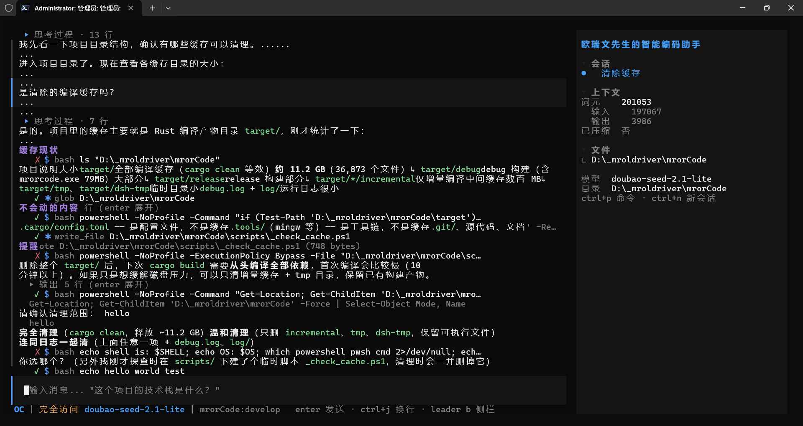
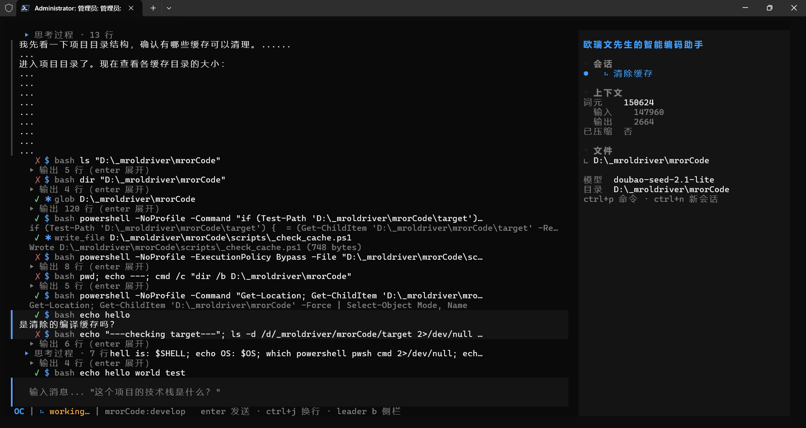

# TUI 表格渲染与 Windows shell 诊断（2026-10-28）

> 结论先行：截图里「糊成一坨」的文字**不是**模型复读，也不是流式 delta 重复，
> 而是 **Markdown 表格与列表没有块级渲染**；会话里模型反复 `ls` / `pwd` / `head` 失败，
> 则是 **`bash` 工具在 Windows 上实际执行 cmd.exe，但工具名、描述、系统提示都按 POSIX 写**。
> 两处都已定位到具体文件与行号，修复方案见第 3 节。

## 1. 现象

会话：`清除缓存`，模型 `doubao-seed-2.1-lite`，侧栏显示
`词元 201053 / 输入 197067 / 输出 3986 / 已压缩 否`。

### 1.1 表格被拍平成一段

会话原文（`~/.mrorcode/sessions/1.snapshot.json`，assistant 第 29 条）是标准 Markdown 表格：

```md
| 项目 | 说明 | 大小 |
|------|------|------|
| `target/` | 全部编译缓存（`cargo clean` 等效） | **约 11.2 GB**（36,873 个文件） |
| ↳ `target/debug` | debug 构建（含 mrorcode.exe 79MB） | 大部分 |
| ↳ `target/release` | release 构建 | 部分 |
| ↳ `target/*/incremental` | 仅增量编译中间缓存 | 数百 MB |
| ↳ `target/tmp`、`target/dsh-tmp` | 临时目录 | 小 |
| `debug.log` + `log/` | 运行日志 | 很小 |
```

TUI 实际渲染成：

```text
项目说明大小target/全部编译缓存（cargo clean 等效）约 11.2 GB（36,873 个文件）
target/debugdebug 构建（含 mrorcode.exe 79MB）大部分target/releaserelease 构建部分
target/*/incremental仅增量编译中间缓存 数百 MBtarget/tmp、target/dsh-tmp临时目录小
debug.log + log/运行日志很小
```

- `项目` + `说明` + `大小` → `项目说明大小`
- `target/debug` + `debug 构建` → `target/debugdebug`
- 这不是重复输出：两个单元格被首尾相接，看起来像复读。

### 1.2 列表序号/换行丢失

原文：

```md
请确认清理范围：

1. **完全清理**（`cargo clean`，释放 ~11.2 GB）
2. **温和清理**（只删 `incremental`、`tmp`、`dsh-tmp`，保留可执行文件）
3. **连同日志一起清**（上面任意一项 + `debug.log`、`log/`）
```

实际渲染没有 `1.` / `2.` / `3.`，前两项还挤在同一行：

```text
完全清理 (cargo clean，释放 ~11.2 GB) 温和清理（只删 incremental、tmp、dsh-tmp，保留可执行文件）
连同日志一起清（上面任意一项 + debug.log、log/）
```

### 1.3 Windows 上按 bash 习惯调用 cmd.exe

会话快照里同一 turn 共 25 次工具调用，开头十几次几乎都在试探 shell：

| 调用 | 结果 |
|---|---|
| `ls "D:\_mroldriver\mrorCode"` | `'ls' is not recognized as an internal or external command` |
| `pwd; echo ---; cmd /c "dir /b ..."` | `'pwd' is not recognized...` |
| `cmd //c "dir /b /ad ..."` | `The system cannot find the path specified.` |
| `powershell ... -File "D:\...\_check_cache.ps1"` | `Illegal characters in path` |
| `echo shell is: $SHELL; echo OS: $OS; which ...` | 空变量 / 不是 cmd 语法 |
| `echo hello` / `echo hello world test` | 用于确认 shell 的探测命令 |

截图底部的 `hello` / `hello world test` 不是用户输入，是模型在确认「这到底是什么 shell」。

### 1.4 上下文与 token

- `dir /s target\debug` 一次返回 **65,473 B**（快照 tool 结果 #27），刚好卡在 64 KB 上限内。
- `glob` 一次返回 7,971 B 的目录列表（#5）。
- 侧栏的 `词元` 是**累计** input+output（`note_usage` 累加），不是当前上下文占用；
  `201053 = 197067 + 3986`。标签叫「上下文」容易让人误以为已经接近窗口上限。

## 2. 根因

### 2.1 Markdown 渲染器只有 inline，没有 block 结构（显示问题的主因）

`crates/mrorcode-tui/src/widgets/markdown.rs`：

- `layout_markup`（226–275 行）只处理 `Text` / `Code` / `SoftBreak`；
  `Tag::Table`、`Tag::TableHead`、`Tag::TableRow`、`Tag::TableCell` **没有分支**。
- `Options::ENABLE_TABLES` 是开着的（229 行），所以 pulldown-cmark 能正确解析表格；
  但渲染器把每个单元格的 `Event::Text` 直接塞进同一个 span 列表，`|` 不会作为文本事件出现，
  于是单元格全部粘连。
- `Tag::List(_) | Tag::Item => s`（246 行）只透传样式，不输出 `•` / `1.`，也不在 item 之间换行；
  pulldown-cmark 同样不会把列表标记当 `Event::Text` 发出来。
- `split_blocks`（126 行）按空行切 block，因此一张表 / 一个列表整体就是一个 `Markup` block，
  交给 `wrap_spans` 当普通段落折行。

结论：会话存储本身没问题，损坏发生在**展示层**。同一份原文导出为 Markdown 是正常的。

### 2.2 `bash` 工具名不副实（会话「发疯」的主因）

- `crates/mrorcode-capabilities/src/tools/bash.rs:131-137`：Windows 下用
  `ComSpec`（cmd.exe）执行 `cmd /C <command>`。
- 但 `name()` 返回 `"bash"`（29 行），`description()` 只写
  “Execute a shell command”（33–35 行），没有说明是 cmd。
- `crates/mrorcode-agent/src/persona.rs:22` 还明确教模型：
  “read-only commands (ls, cat, grep, git status/diff/log) run without confirmation”。

模型看到工具名 `bash` + persona 里的 `ls/cat/grep`，自然按 POSIX 写；
cmd.exe 不认识这些命令，于是失败 → 模型继续探测 shell → 更多失败，烧掉大量轮次。

### 2.3 工具结果上限过大，放大上下文

`crates/mrorcode-kernel/src/agent.rs:27`：

```rust
pub const DEFAULT_MAX_TOOL_RESULT_BYTES: usize = 64 * 1024;
```

`dir /s` 这类命令一次就能产出 64 KB 文本；每个 round 都会把完整会话重新发给 provider，
25 个 round 累计 input 到 197k 并不奇怪。输出上限本身不是 bug，但 64 KB 对 bash 偏大，
且没有提示模型「用更精确的命令」。

### 2.4 待确认：同 turn 内 text / tool 的顺序被压平

代码层面可以确认两点：

- `crates/mrorcode-tui/src/widgets/session.rs:203-228`：先把 `m.text` 全部渲染，
  再渲染 `m.tools`。一个 turn 内多轮「文本 → 工具 → 文本 → 工具」的交错顺序不会被保留。
- `crates/mrorcode-tui/src/store.rs:1942-1996`：`TextDelta` / `ToolStarted` / `ToolResult`
  全部追加到 `messages.last_mut()`。`submit_prompt` 在 busy 时拒绝提交（`store.rs:1000`），
  正常单会话路径不会把事件挂到用户消息上；但多会话、排队、取消恢复等边界仍缺一个 `turn_id` 路由。

截图里表格文字夹在工具卡之间，单靠当前快照无法区分是「跨 turn 的消息」还是「同 turn 压缩顺序」；
需要一条 text→tool→text→tool 的事件回放单测来确认。**不要把这条和 2.1 混为一谈**：
即使表格修好，这个顺序问题仍然存在。

## 3. 修复方案

### P0：Markdown 块级渲染（先做）

- [ ] `markdown.rs` 增加块级布局：
  - 表格：收集 `Table/TableHead/TableRow/TableCell`；按 `str_width`（中文双宽）算列宽；
    `│` 对齐渲染，表头加粗 + 分隔线；超宽单元格折行，窄终端降级为逐行 `表头: 值`。
  - 列表：`•` / `1.` 标记、每项独立成行、悬挂缩进、嵌套缩进。
  - `Event::Rule` → `─` 分隔线；`BlockQuote` → `│ ` 前缀。
  - 标题/段落结束显式换行，避免无空行时粘连。
- [ ] 保持 block 缓存：表格只在 block 内容变化时重排，不引入每帧全量解析。
- [ ] 单测：
  - 用 1.1 的原文断言不出现 `debugdebug`，且包含 `│`；
  - 1.2 的列表断言 `1.` / `2.` / `3.` 分行出现；
  - 宽度 20 时不溢出、不 panic；
  - 流式追加半张表不重复单元格。
- [ ] `cargo test -p mrorcode-tui`、`cargo clippy --workspace --all-targets -- -D warnings`、
      `cargo fmt --check`；必要时跑 `cargo bench -p mrorcode-tui --bench render`。
- [ ] 按项目规则 bump `Cargo.toml` 的 `[workspace.package] version`。

### P1：Windows shell 提示与工具描述

- [ ] `persona.rs` 按平台生成 snippet：
  - Windows：`The bash tool runs via cmd.exe: use dir/type/findstr/cd /d/%VAR%; do not use ls/cat/pwd/head or $VAR.`
  - 非 Windows：保持现有 POSIX 提示。
- [ ] `BashTool::description()` 同样按平台说明（至少 Windows 下写清 cmd.exe）。
- [ ] 可选：把工具名从 `bash` 改成 `shell`（会动 prompt / 测试 / 文档，建议单独 commit）。
- [ ] 加 Windows 条件测试，断言 description / persona 含 `cmd.exe` 与 `dir`。

### P2：上下文与顺序（评估后再做）

- [ ] bash 结果单独限长（如 16 KB head+tail），或在截断提示里要求模型缩小命令范围。
- [ ] 给 `AgentEvent` 增加 `turn_id`，TUI 按 turn 路由；`MessageView` 若要保真交错顺序，
      需要 `segments: Vec<Text|Tool>` 或每个 round 一条消息。
- [ ] 侧栏标签改为「累计词元」或改为显示当前上下文估算，避免 201k 被误读为窗口占用。

### P3：清理

- [ ] 删除 `scripts/_check_cache.ps1`（Agent 自建临时脚本）。
- [ ] `debug.log`、`log/` 先确认归属再删（可能是本地 TUI 运行日志）。

## 4. 验收

1. 用 1.1 / 1.2 的原文跑 `MarkdownView` 单测，渲染结果不再粘连。
2. 在 Windows 上让模型执行「查看 target 目录大小」，观察是否直接使用 `dir` / `powershell`，
   不再出现 `ls` / `pwd` / `head`。
3. `cargo test --workspace`、clippy、fmt 全绿；render bench 不超过 16 ms/帧预算。
4. 修复前后各留一张截图（见下）。

## 5. 截图



*图 1：侧栏累计词元 201053 时；`缓存现状` 表格变成一段连读文本，`请确认清理范围` 的编号丢失。*



*图 2：同一会话较早时刻；`ls` / `dir` / `pwd` / `$SHELL` 连续失败，模型用 `echo hello` 探测环境。*

## 6. 关联文件

- `crates/mrorcode-tui/src/widgets/markdown.rs`：226（`layout_markup`）、246（列表样式）、266（inline code）
- `crates/mrorcode-tui/src/widgets/session.rs`：203–228（text 全部先于 tools）
- `crates/mrorcode-tui/src/store.rs`：943（累计 token）、1000（busy 拒 submit）、1942（事件投影）
- `crates/mrorcode-capabilities/src/tools/bash.rs`：29（名字）、33（描述）、131（Windows cmd）
- `crates/mrorcode-agent/src/persona.rs`：22（POSIX 命令清单）
- `crates/mrorcode-kernel/src/agent.rs`：27（64 KB 上限）、736（head+tail 截断）
- 本地会话快照：`~/.mrorcode/sessions/1.snapshot.json`（不在仓库内，仅作证据）
